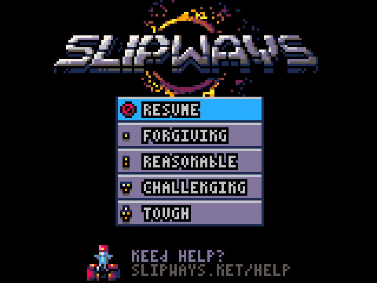
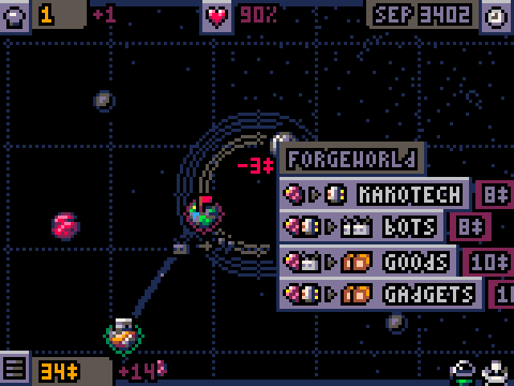

# slipways-love

*Slipways* (PICO-8 edition) ported to Lua for LÖVE 11.5. The game is in `game/`. It is checked headless: a fake LÖVE written in C (`tools/fake_love/`) plays it on 20 recorded replays and compares each capture with a hash the original C port set. The design is in `docs/love-port/design.md`.

  

## Checking the game

Everything runs headless, from the repository root:

```sh
make test                          # unit tests and static guards
make e2e                           # replays tests/e2e/, checks each capture hash
make test-all                      # both
make end-state                     # checks each replay's end state against its .end-state
make replay EVENTS=<events.json>   # replays one file, dump in tmp/replay_dump.txt, capture in tmp/love-replay/
make state EVENTS=<events.json>    # replays one file, last-frame state in tmp/state.txt
make love-capture                  # reruns tools/love_capture/ in real LÖVE 11.5 under Xvfb, rewrites its PNGs
make help                          # every target
```

## Playing the Lua game

`make love` writes `tmp/slipways.love`; run it with LÖVE 11.5 (`love tmp/slipways.love`). It needs a gamepad: the game reads no keyboard.

## Controls

The game reads 12 numbered buttons. Its default bindings are `game/game/bindings_default.lua`. A personal `bindings.cfg`, read by `love.filesystem`, replaces them; `bindings.default.cfg` documents that format with every mode and action. The pad table of `docs/love-port/design.md` maps the numbers to LÖVE gamepad buttons.

## To do

Rule for this list: each item is one clear sentence of at most 30 words, readable without any outside reference.

- [ ] Add a cheat that grants bonus score points, so a short e2e can show the score panel's lit stars.
